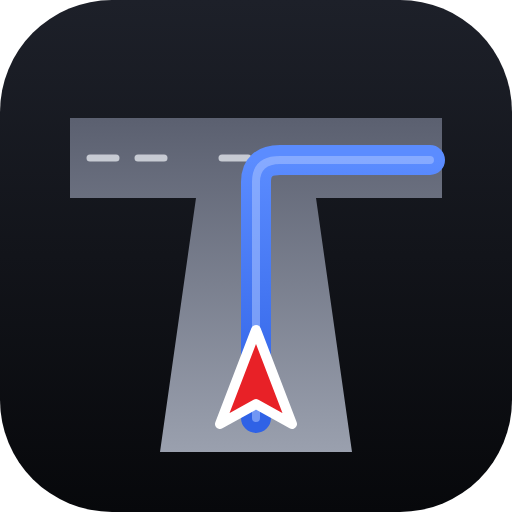
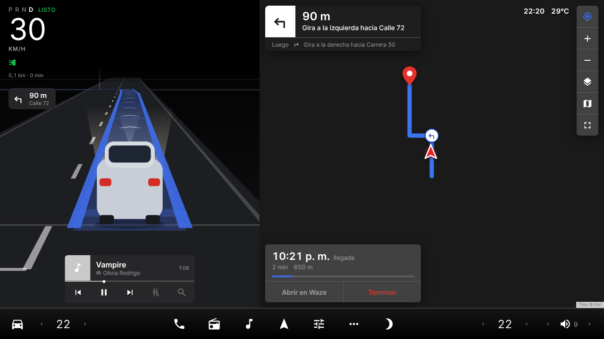
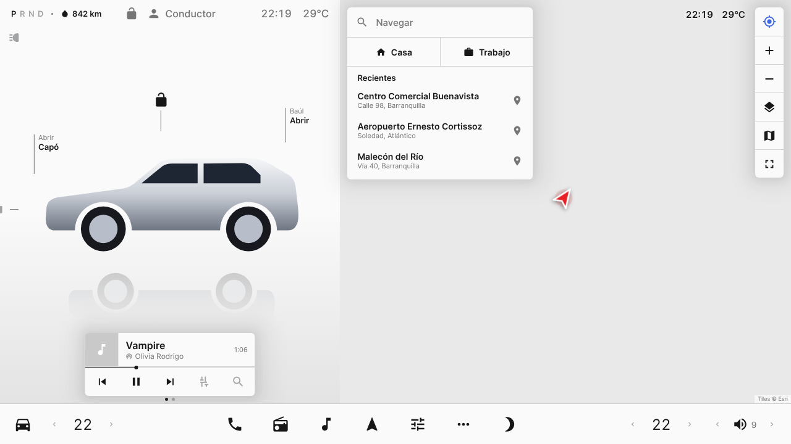
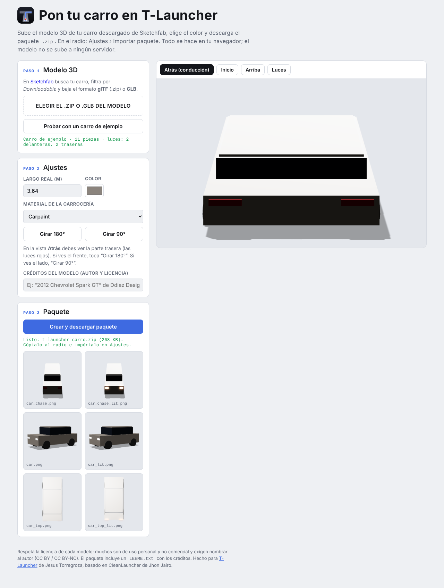

<p align="center"></p>

# T-Launcher

🌐 **Página y tutorial:** https://t-launcher.vercel.app · **Generador del carro:** https://t-launcher.vercel.app/generador/

Pantalla de inicio estilo Tesla para radios Android de carro (Android 8 a 14), hecha en Colombia 🇨🇴 por **Jesus Torregroza**.

<p align="center">
  
  
</p>

## Qué hace

**Funciona de verdad**

- **Navegación dentro de la pantalla:** busca direcciones colombianas ("Calle 72 # 46-30") o lugares, traza la ruta, muestra la tarjeta de giro y la hora de llegada, y da indicaciones por voz. Si usas Waze o Google Maps, también muestra sus indicaciones.
- **Vista de conducción tipo Tesla:** tu carro sobre la forma real de las calles del mapa, con la ruta azul, flechas de dirección, semáforos y señales de PARE.
- **Aviso de cámaras de fotomultas** registradas en OpenStreetMap.
- **Pico y placa** automático por GPS: Bogotá, Medellín, Cali, Bucaramanga, Cartagena y Manizales, o modo manual.
- **Velocidad por GPS:** naranja por encima de 80 km/h y roja por encima de 100. Muestra el límite de la vía.
- **Música:** carátula, canción y controles de Spotify, YouTube Music y otras.
- **Tema de noche** a partir de las 6:01 p. m. o al encender las luces (si el radio lo permite), clima, kilometraje y recordatorio de aceite.

**Simulado (solo visual):** los cambios P-R-N-D (se deducen de la velocidad), los botones de seguro, capó y baúl, la temperatura de la barra y los carros alrededor. **No es un piloto automático:** no frena ni maneja.

---

## Tutorial

### 1. Instalar

1. Descarga **T-Launcher.apk** desde la sección [**Releases**](../../releases) de este repositorio.
2. Pásalo al radio con una USB, o descárgalo directo en el radio.
3. Ábrelo con el explorador de archivos y toca **Instalar**. Si el radio lo pide, permite *instalar apps de origen desconocido*.

### 2. Ponerlo como pantalla de inicio

Presiona el botón **Inicio** del radio y elige **T-Launcher** → **Siempre**.

Si no aparece esa pregunta, ve a **Ajustes › Apps › Apps predeterminadas › App de inicio** y elige T-Launcher.

### 3. Primer uso (2 minutos)

La primera vez se abre **Ajustes**:

1. Escribe tu **nombre** y tu **placa** (para el pico y placa).
2. Permite la **ubicación**: sirve para el GPS, el clima y la navegación.
3. Activa **Ver la música** (acceso a notificaciones). También sirve para leer las indicaciones de Waze.
   - Si Android no te deja: **Ajustes del radio › Apps › T-Launcher › menú ⋮ › Permitir ajustes restringidos**, y vuelve a intentarlo.

### 4. Navegar

- Toca **Navegar** y escribe una dirección ("Calle 72 # 46-30") o un lugar. Elige el resultado y la ruta se traza sola.
- **Casa** y **Trabajo:** la primera vez te piden la dirección. Para cambiarla, mantén presionado el botón.
- **Abrir en Waze** manda el mismo destino a Waze o Google Maps.
- Al arrancar, la pantalla pasa sola a la vista de conducción. Cuando te detienes un rato, vuelve al inicio.

### 5. Voz en español latino

Si las indicaciones suenan con acento de España, al radio le falta una voz latina:

1. Instala **[SherpaTTS](https://f-droid.org/packages/org.woheller69.ttsengine/)** (gratis) y descarga dentro de ella una voz **es_MX**.
   - También sirve **Servicios de voz de Google** con la voz "Español (Estados Unidos)".
2. En T-Launcher ve a **Ajustes › Voz en español latino** y elige ese motor.
3. Prueba en **Ajustes › Probar la voz de navegación**. Debe decir "Voz latina".

### 6. Pon tu propio carro en 3D



1. En **[Sketchfab](https://sketchfab.com/search?features=downloadable&q=car&type=models)** busca el modelo de tu carro. Filtra por *Downloadable* y descárgalo en formato **glTF** (.zip) o **GLB**.
   - Revisa la licencia del modelo. La mayoría exige nombrar al autor y muchas no permiten uso comercial.
2. Abre el **[generador de paquetes](https://t-launcher.vercel.app/generador/)**: sube el modelo, elige el color y revisa que en la vista "Atrás" se vea la parte trasera. Si no, toca "Girar 180°".
3. Toca **Crear y descargar paquete**. Te descarga `t-launcher-carro.zip`.
4. Pasa ese .zip al radio y ve a **Ajustes › Importar paquete del carro (.zip)**.

El generador funciona en el navegador del computador o del celular, y el modelo no se sube a ningún servidor.

<br clear="right">

### 7. Volver al launcher de fábrica

**Ajustes del radio › Apps › T-Launcher › Abrir de forma predeterminada › Borrar valores predeterminados**, o desinstala la app.

---

## Créditos

**T-Launcher** fue creado por **Jesus Torregroza**, a partir de estos trabajos:

- **[CleanLauncher](https://github.com/jhontandazo008/CleanLauncher)** de **Jhon Jairo** (jhontandazo008): el launcher original para radios Android sobre el que se construyó T-Launcher.
- **Modelo 3D del Chevrolet Spark GT** usado en las capturas y en la versión personal: ["2012 Chevrolet Spark GT 1.2 LT"](https://sketchfab.com/3d-models/2012-chevrolet-spark-gt-12-lt-78557059b7194451a8ac2ad8f9a04d7d) de **[Ddiaz Design](https://sketchfab.com/ddiaz-design)**, licencia [CC BY-NC-SA 4.0](http://creativecommons.org/licenses/by-nc-sa/4.0/).
- **Diseño de la interfaz** basado en "Tesla Dashboard UI Component Library" de **Nami** (Figma Community, CC BY 4.0).
- Mapas © colaboradores de [OpenStreetMap](https://www.openstreetmap.org/copyright), servidos por [OpenFreeMap](https://openfreemap.org/). Rutas: [OSRM](https://project-osrm.org/). Búsqueda: [Photon](https://photon.komoot.io/) y [Nominatim](https://nominatim.org/). Clima: [Open-Meteo](https://open-meteo.com/). Mapa de respaldo: Leaflet y Esri. Letra Inter (SIL OFL). Vista 3D: [three.js](https://threejs.org/).

Proyecto personal, gratuito y sin fines comerciales. No es un producto de Tesla, Inc. ni de General Motors / Chevrolet; esas marcas pertenecen a sus dueños.

---

## Para desarrolladores

### Compilar

Sin Gradle. En Linux:

```sh
sudo apt install aapt dalvik-exchange zipalign apksigner default-jdk
ANDROID_JAR=/ruta/platforms/android-33/android.jar sh build_linux.sh   # → build/T-Launcher.apk
```

- Sin lambdas en Java: `dx` no las convierte y la app se cierra al abrir. Usa clases anónimas.
- Para actualizar la app sin desinstalarla, firma siempre con la **misma** keystore.
- **Versión con tu carro incluido:** pon las imágenes del paquete en una carpeta y compila con `PERSONAL_CAR=/ruta/carpeta sh build_linux.sh`. La carpeta `personal/` está en `.gitignore`.

### Estructura

- `assets/home.html`: toda la interfaz (WebView), con el mapa (MapLibre + OpenFreeMap), la vista de conducción en canvas y la navegación.
- `src/com/simple/carlauncher/`: puente con Android (GPS, música, luces, voz, buscador de direcciones), Ajustes y pico y placa.
- `docs/generador/`: generador web de paquetes del carro (three.js). Actívalo con **GitHub Pages** (Settings › Pages › rama principal, carpeta `/docs`).

### Actualizar las reglas de pico y placa

Están en `src/com/simple/carlauncher/PicoRules.java` (bloque `static { ... }`): dígitos por día, horario y fecha de vigencia por ciudad. Las alcaldías rotan cada trimestre o semestre.
